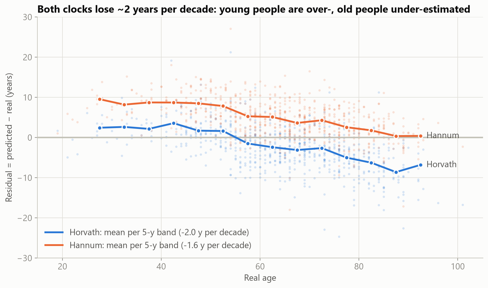
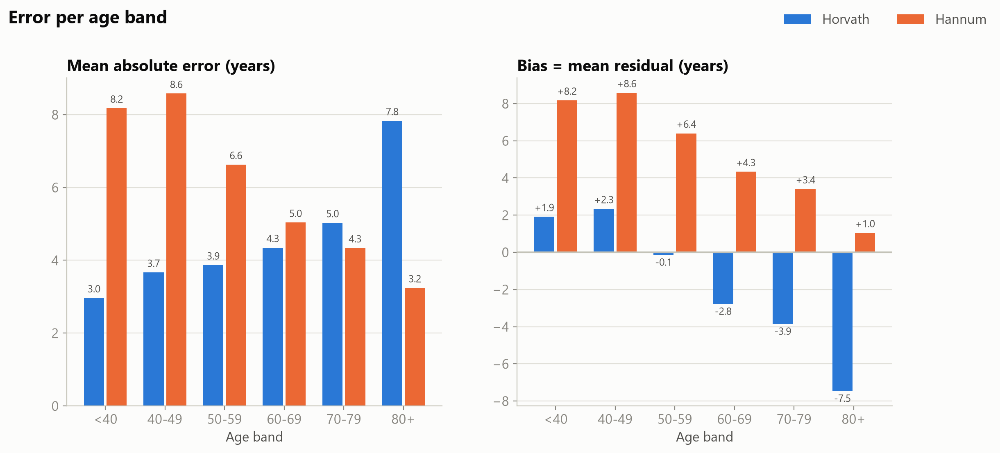
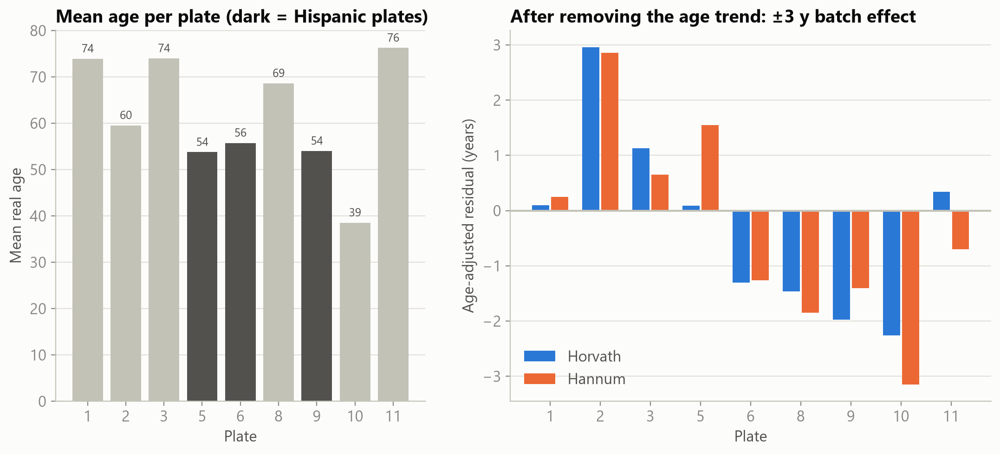
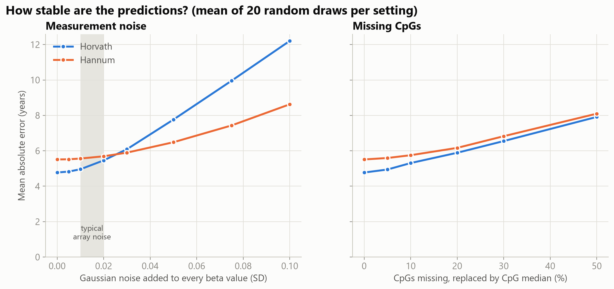
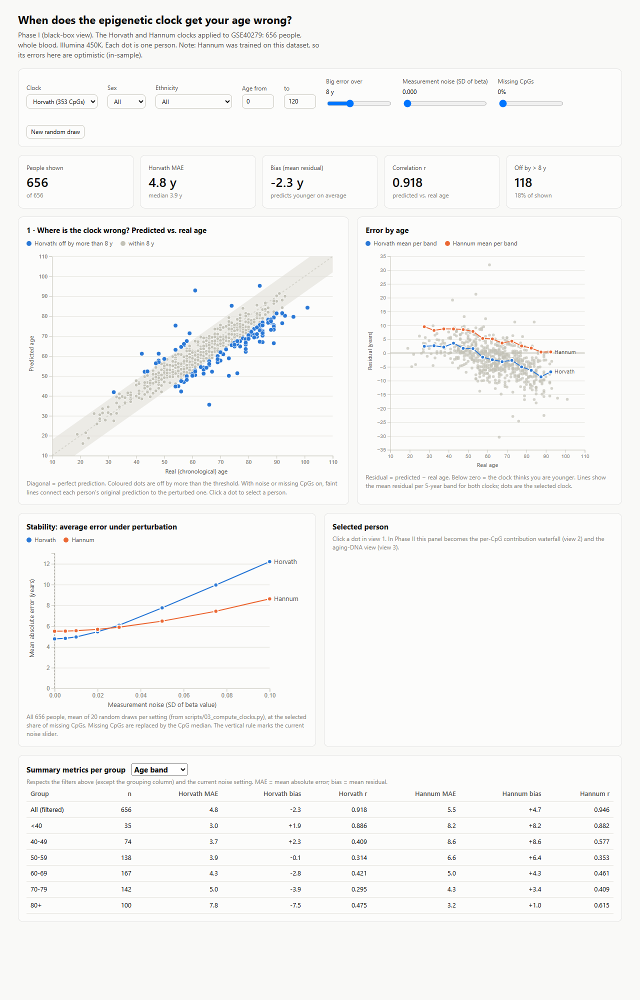

# When does the epigenetic clock get your age wrong, and why?

**Team Neural Ninjas**, AI and Visualization Lab WS26, JKU Linz

| Student ID | Name | Phase I |
|---|---|---|
| K12556511 | Ali Haider Warraich | with GenAI |
| K01421148 | Carola Gödeke | with GenAI |
| K12338096 | Abrar Ahmad | without GenAI |
| K12557466 | Haseeb Ahmed | without GenAI |

Midpoint progress video (≤ 5 min): `video/progress_update.mp4` · [Watch on Google Drive](https://drive.google.com/file/d/1V7iFklE4GC859v1lBsFXu_ly4wSPpNKX/view?usp=sharing)

---

## Task

Epigenetic clocks are pre-trained models that estimate a person's age from DNA methylation measured at a few hundred CpG sites in blood. They are widely used but not perfect. We treat two published clocks as the **AI models under investigation**:

- **VIS4AI, Phase I (black box, this midpoint):** find *where* and *for whom* the clocks are wrong, using an interactive visualization.
  - **RQ1:** For which people, age ranges or groups do the clocks make large errors? Are the errors systematic (bias) or random?
  - **RQ2:** How stable are the predictions when the input is perturbed (measurement noise, missing CpGs)?
- **VIS4AI, Phase II (white box, next):** explain the errors by showing which CpG sites drive each prediction (contribution waterfall) and how those sites behave across age.
  - **RQ3:** Which CpG sites push a wrong prediction up or down, and why do they fail for the affected group?
- **AI4VIS:** one pair works with generative AI, the other without; the pairs swap in Phase II. See [`ai-interactions/`](ai-interactions/) and [`ai_reflection_midpoint.md`](ai_reflection_midpoint.md).

**Working hypothesis:** the clocks are linear, but some CpGs stop changing in old age (saturation), so the clocks underestimate very old people.

## Models

Both models are pre-trained and published. We do not train them; we apply and analyse them. Both are linear in the CpG beta values (0 = unmethylated, 1 = fully methylated).

| | Horvath clock | Hannum clock |
|---|---|---|
| Paper | Horvath, *Genome Biology* 2013, [doi:10.1186/gb-2013-14-10-r115](https://doi.org/10.1186/gb-2013-14-10-r115) | Hannum et al., *Molecular Cell* 2013, [doi:10.1016/j.molcel.2012.10.016](https://doi.org/10.1016/j.molcel.2012.10.016) |
| CpG sites | 353 + intercept (0.695507258) | 71, no intercept |
| Trained on | many tissues (elastic net) | whole blood (elastic net), **on GSE40279 itself** |
| Output | `anti_trafo(intercept + Σ w·β)`; for adults that is `21·s + 20` | `Σ w·β` (years) |
| Implementation | Python ([`scripts/03_compute_clocks.py`](scripts/03_compute_clocks.py)) | same |

Weights: the published coefficients, from the [biolearn](https://github.com/bio-learn/biolearn) CSVs (`data/clock_weights/`).

**Verification:** coefficients and all 656 predictions are identical to the official R package [methylclock](https://bioconductor.org/packages/methylclock) 1.18.0 / methylclockData 1.20.0, with max difference 0.0000 years ([`scripts/05_methylclock_crosscheck.R`](scripts/05_methylclock_crosscheck.R), [`data/processed/crosscheck_summary.csv`](data/processed/crosscheck_summary.csv)).

## Datasets

| Dataset | Content | Use |
|---|---|---|
| [GSE40279](https://www.ncbi.nlm.nih.gov/geo/query/acc.cgi?acc=GSE40279) | 656 people, whole blood, Illumina 450K; age 19–101, sex, ethnicity (Caucasian-European / Hispanic-Mexican), 9 processing plates. Values: BeadStudio average beta | Core dataset (Phase I and II). **Caveat:** Hannum was trained on it, so Hannum results are in-sample |
| [GSE87571](https://www.ncbi.nlm.nih.gov/geo/query/acc.cgi?acc=GSE87571) | 732 people, whole blood, 450K | Planned: independent test set (extra) |
| [GPL13534](https://www.ncbi.nlm.nih.gov/geo/query/acc.cgi?acc=GPL13534) | 450K chip annotation | Planned: gene/chromosome of CpGs (Phase II) |

The 1.2 GB GSE40279 series matrix is **not** committed (`.gitignore`); `scripts/01_download_data.py` downloads it. Everything derived from it is in `data/processed/`. All 418 clock CpGs are present with 0 missing values, so no imputation was needed.

## Phase I results

| Clock | MAE | Median AE | r | Bias | Off by > 8 y |
|---|---|---|---|---|---|
| Horvath | 4.8 y | 3.9 y | 0.92 | −2.3 y | 18 % |
| Hannum | 5.5 y | 5.1 y | 0.95 | +4.7 y | 25 % |

1. **The error depends on age (RQ1, hypothesis supported).**
   - Both clocks lose about 2 years per decade (Horvath −2.0, Hannum −1.6 y/decade).
   - Horvath's bias goes from +1.9 y (<40) to **−7.5 y (80+)**; half of the over-80s are off by more than 8 y.
   - This is systematic bias, not noise.

   
2. **Hannum overestimates almost everyone (+4.7 y),** despite being in-sample.
   - methylclock gives identical values, so this is clock behaviour, not an implementation error.
   - Hannum only looks best at 80+ because the offset cancels the old-age underestimate.
   - It overestimates men more than women (+6.0 vs. +3.6 y).

   
3. **Batch effect, confounded with age.**
   - Mean age per plate ranges from 39 to 76 y, and all Hispanic participants are on plates 5, 6 and 9.
   - After removing the age trend, a ±3 y plate effect remains.

   
4. **Stability (RQ2).**
   - At realistic array noise (SD 0.01–0.02), MAE grows by less than 1 y.
   - Under stronger noise, Horvath degrades about twice as fast as Hannum: its weights are larger and are ×21 in years.
   - Missing CpGs (median-imputed) hurt both clocks equally.

   

All charts: [`figures/`](figures/). Predicted vs. real age: [`figures/fig1_predicted_vs_real.png`](figures/fig1_predicted_vs_real.png).

## Interactive visualization

Open [`visualization/index.html`](visualization/index.html) in a browser. It needs no server, but needs internet once to load D3.js.

- **Filters:** clock, sex, ethnicity, age range, big-error threshold.
- **Perturbation:** noise and missing-CpG sliders recompute both clocks live in the browser.
- **Views:** predicted vs. real age; error by age for both clocks; stability chart; selected-person panel (becomes the Phase II contribution view); metrics per age band / sex / ethnicity / plate.



## Repository structure

```
├── README.md                    task, models, datasets, results (this file)
├── team-info.json, workload.json
├── ai-interactions/             GenAI interaction records (Phase I, AI-aided pair)
├── ai_reflection_midpoint.md    reflection on GenAI use in Phase I
├── scripts/
│   ├── 01_download_data.py          GEO data + clock weights
│   ├── 02_extract_clock_cpgs.py     stream 473k×656 matrix → 418 clock CpGs + sample table
│   ├── 03_compute_clocks.py         clocks, residuals, group metrics, perturbation test
│   ├── 04_build_visualization_data.py → visualization/data.js
│   ├── 05_methylclock_crosscheck.R  verification against methylclock (R)
│   ├── 06_make_figures.py           → figures/*.png
│   
├── data/
│   ├── clock_weights/           Horvath1.csv, Hannum.csv
│   └── processed/               samples, clock CpG betas, predictions, metrics, perturbation, cross-check
├── visualization/               index.html + data.js (interactive Phase I view)
├── figures/                     static charts + UI screenshots
```

## Reproduce

Requires Python ≥ 3.11 on Windows (PowerShell); R 4.6 is optional for the cross-check.

```powershell
powershell -ExecutionPolicy Bypass -File .\run_all.ps1       # scripts 01–04 and 06 (~10 min, 1.2 GB download)
& "C:\Program Files\R\R-4.6.2\bin\Rscript.exe" scripts\05_methylclock_crosscheck.R   # needs BiocManager::install(c("methylclock","methylclockData"))
.\.venv\Scripts\python.exe -I scripts\07_make_video.py       # needs ffmpeg; Windows text-to-speech
```

The scripts are plain Python and run on other systems too. Only `run_all.ps1` and the narration step of `07_make_video.py` are Windows-specific.

## Next steps (Phase II)

- Per-CpG contribution waterfall (`w·β`; ×21 for Horvath in years) for a selected person.
- Aging-DNA view: test the CpG-saturation hypothesis.
- GPL13534 annotation.
- Extras: GSE87571 as an independent dataset, cell-composition check, XGBoost + SHAP as a non-linear contrast.
